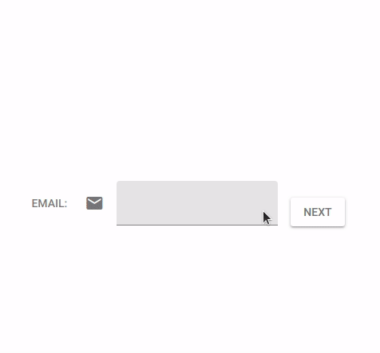

# QInputEx - Advanced Input Component for Quasar v2

An advanced input component for Quasar Framework v2 that provides enhanced input types including date, time, password, color, search, and more.



## Features

- 🎯 **Multiple Input Types**: date, time, datetime, fulltime, password, color, search, and more
- 🔍 **Search with History**: Built-in search history management with pinned items
- 📅 **Smart Date/Time Pickers**: Integrated with Quasar's QDate and QTime components
- 🎨 **Color Picker**: Built-in color selection support
- 🔐 **Password Toggle**: Show/hide password functionality
- 🎰 **Custom Input Types**: Easy to create and register new input types
- 💪 **TypeScript Support**: Full TypeScript support with type definitions
- 🚀 **Vue 3 & Composition API**: Built for Vue 3 with Composition API

## Requirements

- Quasar v2.0.0+
- Vue 3.0.0+
- Vue I18n 9.0.0+

## Installation

### As a Quasar App Extension (Recommended)

```bash
quasar ext add qinputex
```

This will handle all the setup automatically, including:
- Installing the npm package
- Registering components globally
- Adding necessary boot files
- Configuring your project

### Manual Installation

```bash
npm install qinputex
# or
yarn add qinputex
# or
pnpm add qinputex
```

### Quasar Configuration

Enable required Quasar components in your `quasar.config.js`:

```javascript
framework: {
  components: [
    'QBtn',
    'QIcon', 
    'QPopupProxy',
    'QCard',
    'QCardSection',
    'QToolbar',
    'QToolbarTitle',
    'QInput',
    'QSelect',
    'QDate',
    'QTime',
    'QColor',
    'QChip'
  ]
}
```

## Usage

### Basic Usage

```vue
<template>
  <q-input-ex v-model="value" type="date" />
</template>

<script setup>
import { ref } from 'vue'
import { QInputEx } from 'qinputex'

const value = ref('')
</script>
```

### Available Input Types

- `text` - Standard text input
- `textarea` - Multi-line text input
- `number` - Number input
- `date` - Date picker (YYYY/MM/DD)
- `time` - Time picker (HH:mm)
- `fulltime` - Time picker with seconds (HH:mm:ss)
- `datetime` - Combined date and time picker
- `color` - Color picker
- `password` - Password input with visibility toggle
- `search` - Search input with history management

### Search Input with History

```vue
<template>
  <q-input-ex
    v-model="searchValue"
    type="search"
    @search="handleSearch"
    :q-input-history="{
      history: searchHistory,
      pinHistory: [
        { icon: 'cake', value: 'Popular search 1' },
        { icon: 'phone', value: 'Popular search 2' }
      ],
      maxHistory: 5,
      icon: 'search',
      color: 'primary',
      textColor: 'white'
    }"
  />
</template>

<script setup>
import { ref } from 'vue'
import { QInputEx } from 'qinputex'

const searchValue = ref('')
const searchHistory = ref([])

const handleSearch = (value) => {
  console.log('Searching for:', value)
  // Add to history
  if (!searchHistory.value.includes(value)) {
    searchHistory.value.unshift(value)
  }
}
</script>
```

### Slots

QInputEx supports all QInput slots plus two additional external slots:

**Internal slots** (same as QInput):
- `before`
- `prepend`
- `append`
- `after`

**External slots** (new):
- `top` - Content above the input
- `bottom` - Content below the input

### Custom Input Types

You can create and register custom input types:

```javascript
import { register } from 'qinputex'

const CustomDateInput = {
  name: 'custom-date',
  type: 'tel',
  mask: 'date',
  rules: ['date'],
  attaches: {
    append: {
      icon: 'event',
      popup: {
        name: 'QDate',
        attrs: {
          'today-btn': true,
          mask: 'YYYY/MM/DD'
        },
        on: {
          input(value, reason, detail, attach) {
            // Auto-close on date selection
            if (['day', 'today'].includes(reason)) {
              attach.popup?.hide()
            }
            return value
          }
        }
      }
    }
  }
}

register(CustomDateInput)
```

## Migration from Quasar v1

If you're migrating from Quasar v1, please refer to the [Migration Guide](./MIGRATION_GUIDE.md).

Key changes:
- Use `v-model` instead of `:value` and `@input`
- Vue 3 Composition API support
- Updated event names (e.g., `@update:modelValue`)

## Development

```bash
# Install dependencies
pnpm install

# Start dev server
pnpm dev

# Build for production
pnpm build

# Run tests
pnpm test
```

## License

MIT

## Contributing

Contributions are welcome! Please feel free to submit a Pull Request.